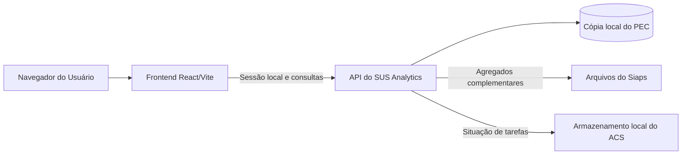

<p align="center">
  <h1 align="center">SUS Analytics Web</h1>
</p>

<p align="center">
  Painel web para visualização de contratos analíticos, acompanhamento territorial e apoio à gestão de dados da Atenção Primária à Saúde.
</p>

<p align="center">
  <a href="https://github.com/sus-digital-labs/gerencia-aps/actions/workflows/ci.yml">
    
  </a>
  <a href="LICENSE">
    
  </a>
  
  
</p>

<p align="center">
  <a href="#visão-geral">Visão geral</a> ·
  <a href="#instalação">Instalação</a> ·
  <a href="#uso-rápido">Uso rápido</a> ·
  <a href="#arquitetura">Arquitetura</a> ·
  <a href="#segurança">Segurança</a> ·
  <a href="#contribuição">Contribuição</a>
</p>

---

## Visão geral

O SUS Analytics Web acompanha a Atenção Primária à Saúde por unidade, equipe e competência. A aplicação consulta diretamente uma cópia autorizada do e-SUS PEC e apresenta os indicadores de Qualidade APS e Vínculo e Acompanhamento Territorial do Saúde Brasil 360.

## Principais recursos

| Recurso | Descrição |
|---|---|
| Indicadores e vínculos | Catálogo de 21 métricas, séries, contribuições nominais e importação de fontes do Siaps. |
| Gestão ACS | Visitas por equipe e microárea, ranking, histórico nominal e tarefas de acompanhamento com estado local. |
| Território e vigilância | Mapa agregado, microáreas, análise de cobertura e práticas registradas no PEC. |
| Relatórios | Produção, BPA, RAS, imunização, comparativo, diagnósticos registrados e modelos personalizados, com CSV de conferência. |

## Uso rápido

Use o perfil Docker com uma cópia local do PEC e um operador habilitado. O diretório de unidades e equipes, os filtros e as listas nominais vêm da conexão com o banco.

## Instalação

No ANTON-254, tanto a instalação local quanto os comandos de desenvolvimento rodam em Docker.

### Docker (Recomendado)

No ANTON-254, com a cópia `pec-anton223-db` ativa na rede Docker privada `pec-anton223-local`, execute na raiz do repositório:

```bash
bash docker/up-local.sh
```

A aplicação abre na [página de login local](http://127.0.0.1:18185/login). Use as credenciais padrão do superadmin. O launcher lê `shared_superadmin_user_email.txt` e `shared_admin_user_password.txt` em `/srv/projects/dm-hub/secrets/` e monta apenas um verificador criptográfico no container da aplicação. Para usar outra porta no host, defina `SUS_ANALYTICS_PORT` ao executar o launcher.

O launcher usa a imagem local `node:24-bookworm-slim`, provisiona a credencial exclusiva do banco local, compila a interface original de `apps/frontend` dentro do Docker quando o código muda e espera a confirmação da origem em `/readyz`. O projeto Docker `sus-analytics-web-anton254` tem nome, volumes, configuração privada e rede de ingresso próprios. O serviço volta a subir após reinício do Docker.

O painel consulta diretamente a cópia local do PEC para apurar o catálogo Saúde Brasil 360. Os cartões mostram resultados apurados, evidências parciais e fontes pendentes. A política metodológica e as fontes estão no [catálogo do Saúde Brasil 360](docs/13-saude-brasil-360/README.md).
Os 21 códigos seguem o registro canônico, com recortes de equipe e competência. Para fornecer PBF/BPC, parâmetro populacional e avaliações do Meu SUS Digital, use o [contrato de complementos do CVAT](docs/13-saude-brasil-360/complementos-cvat-local.md).

O cache em memória guarda agregados por equipe, unidade, competência e versão da regra durante cinco minutos. A lista nominal paginada consulta o cadastro atual ou as contribuições dos indicadores compatíveis diretamente no PEC. A interface exibe o nome e, quando aplicável, as contribuições do indicador. A aplicação roda sem logs e o manifesto publica o serviço em loopback.

Para validar a árvore em isolamento, execute `bash docker/test-pec-local.sh` com as imagens indicadas no script e um volume com as dependências do perfil local. O procedimento usa um banco descartável.

### Desenvolvimento Local

Execute os scripts abaixo em um container de desenvolvimento com Node.js 24 e a versão de pnpm fixada em `package.json`.

```bash
pnpm install --frozen-lockfile
pnpm check
pnpm test
pnpm build
```

## Configuração

Para empacotar a distribuição pública, use `docker build -f docker/Dockerfile -t sus-analytics-web .`. O runtime recebe `SUS_PEC_HOST`, `SUS_PEC_DATABASE` e `SUS_PEC_USER` e lê a senha em `/run/secrets/pec_password`. O verificador do operador fica em `/run/secrets/operator_login`. Gere o verificador com `buildOperatorVerifier` de `apps/backend/local/operator-auth.ts` a partir de arquivos privados com o e-mail e a senha do operador, como faz o launcher.

Publique a porta interna `3000` em loopback. Monte `/run/b360` para os complementos e relatórios municipais do Siaps e `/run/acs-state` para persistir situações de tarefas. Use uma conta PostgreSQL de leitura com permissão nas relações PEC consultadas pelo painel. `/healthz` confirma o processo e `/readyz` confirma o acesso à cópia local.

## Arquitetura



O navegador acessa somente a API autenticada. Consultas nominais são paginadas e excluídas do cache. A edição de situações de tarefas fica no armazenamento local da aplicação.

## Estrutura do repositório

```text
.
├── apps/               # Módulos de aplicação principal e backend/core local
├── docker/             # Configurações de container e Docker Compose
├── docs/               # Documentação de arquitetura e contratos
├── scripts/            # Ferramentas locais de validação de build
├── .github/            # Workflows CI (Build e Security)
└── package.json        # Dependências do workspace
```

Para aprofundamento técnico, consulte `docs/architecture/product-boundary.md` e `docs/DEVELOPMENT.md`.

## Testes e qualidade

O projeto inclui *gates* rigorosos de publicação. Em ambiente local, execute:

```bash
pnpm check      # Validação estática de tipos (TypeScript)
pnpm format     # Verificação e aplicação do Prettier
pnpm test       # Executa a suite de testes locais (Vitest)
pnpm build      # Compilação e empacotamento com Vite/esbuild
```

A esteira de Continuous Integration executa verificações de testes, *typecheck* e *container security* a cada Pull Request.

## Segurança

A segurança foi pensada baseada na postura isolada do painel:

- **Política de *Secrets*:** Nenhum segredo ou token privado é hospedado localmente no código. Utilizar `.env` exclusivamente com dados sintéticos ou restritos.
- **Isolamento de Responsabilidade:** Funcionalidades vitais, como autorização, controle de acesso e cálculo distribuído, são tratadas explicitamente como "contratos externos", evitando o processamento de regras sigilosas no frontend.
- **Reporte:** Caso descubra problemas de segurança, utilize o mecanismo privado padrão do GitHub (`Security > Advisories`). Não publique informações sensíveis em issues abertas.

## Roadmap

| Status | Item |
| ------ | ---- |
| ✅ | Renderização de SPA e roteamento base experimental |
| ✅ | Validação fail-closed rigorosa de payloads externos |
| 🚧 | Documentação estendida de uso das métricas do catálogo APS |
| 🚧 | Visualização completa do acompanhamento territorial |
| 🧭 | Integração com provedor robusto de autenticação multiusuário |

## Contribuição

Contribuições para o refinamento da interface, documentação e correção de testes locais são muito bem-vindas.

1. Faça um *fork* e crie sua branch de desenvolvimento.
2. Certifique-se de executar `pnpm test` e `pnpm check`.
3. Abra um Pull Request e aguarde a validação dos *workflows* do GitHub Actions.

Para diretrizes detalhadas de código e colaboração, consulte a documentação ou a arquitetura.

## Licença

Distribuído sob a licença Apache 2.0. Consulte [LICENSE](LICENSE) e [NOTICE](NOTICE) para os devidos limites legais de cópia, distribuição e modificação.

## Créditos / Mantenedor

O software é mantido por Eduardo Muniz.

Este projeto é uma ferramenta de apoio analítico e **não tem intenção de substituir** o e-SUS APS, PEC Oficial ou os relatórios institucionais do Ministério da Saúde. Use com responsabilidade.
